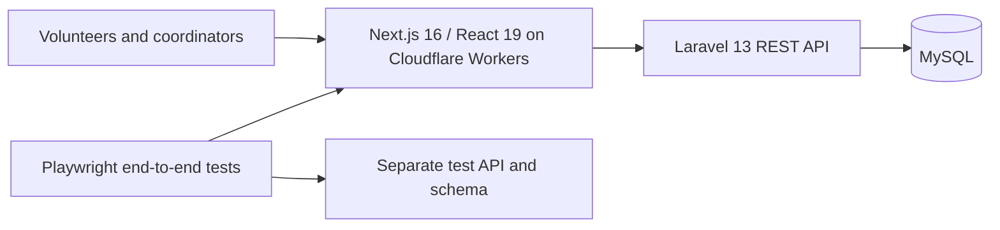

# ChristFlow: volunteer coordination case study

A scheduling and volunteer coordination system for a Christian organization that helps people experiencing homelessness. Volunteers, partner communities and resources (kitchens, rooms) are planned in one place instead of Facebook groups and spreadsheets.

> The code is private and the system belongs to the organization. This page describes the problem, the architecture and the engineering decisions.

## Problem

Street outreach runs on volunteers. Coordinators kept schedules in Facebook threads, spreadsheets and messengers. Nobody saw early that a shift was critically understaffed, reminders were manual, and information got lost in threads. Commercial tools assume individual sign-ups or a single large church; none supports a partner community taking a whole date and recruiting its own people.

## What it does

- Events and shifts with roles (responsibility types) and partner organizations
- Self-service sign-up through links, without creating accounts for every volunteer
- Resource booking (kitchens, rooms) next to the schedule

## Architecture

## Engineering decisions

- **Edge frontend, simple backend.** The frontend runs on Cloudflare Workers; the API is a plain Laravel application, cheap to host for a non-profit.
- **Isolated environments.** Production, development and end-to-end tests have separate database schemas and API instances, so tests can never wipe real data.
- **Verified backups.** The backup script restores every dump into a temporary schema and compares row counts table by table; it fails loudly if the copy differs.
- **Build-time configuration checked.** The deploy scripts take the public API URL from the deployed Workers config, because values baked into the bundle at build time would otherwise silently point production at the development API.

## Stack

Next.js 16 · React 19 · Cloudflare Workers · Laravel 13 · PHP · MySQL · Docker · Playwright
